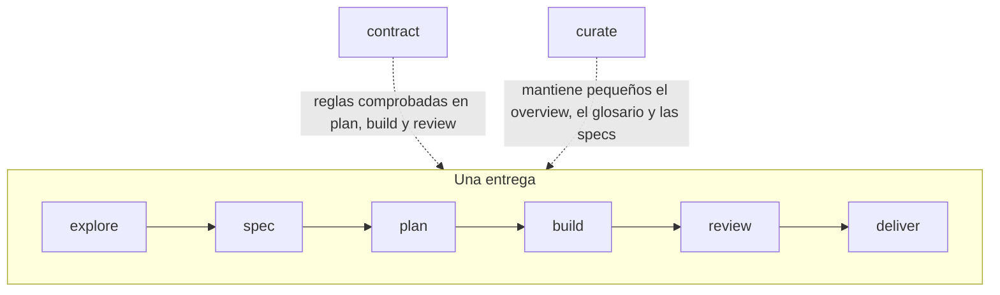

# El flujo

Nueve fases. Siete forman el camino de una entrega, con `fix` como el camino
corto para un defecto; dos son transversales. Cada fase tiene una palabra, y
esa palabra es el comando del CLI, el fichero de workflow y el skill. Invocas
una fase con su skill; el skill ejecuta el comando de la fase; el comando se
niega mientras falte un paso obligatorio y, si no, imprime el workflow, las
reglas y el contexto. La [entrega guiada](guided.md) sigue un cambio a través
de cada paso, con los comandos y los ficheros que escribe cada uno.



| Fase | Dile a tu cliente | Produce | Quién decide |
| --- | --- | --- | --- |
| [explore](explore.md) | `/atipspec-explore <slug>: <idea>` | `brief.md` | tú: haz la spec, acótala o descártala |
| [spec](spec.md) | `/atipspec-spec <slug>: <what you want>` | escenarios en `specs/<capability>.md`, el `spec.md` de la entrega | tú apruebas la propuesta, con el plan. **Punto de parada 1** |
| [fix](fix.md) | `/atipspec-fix <slug>: <the defect>` | el requisito aceptado que rompe, corregido, y un plan de una tarea | tú apruebas la propuesta. **Punto de parada 1** |
| [plan](plan.md) | `/atipspec-plan <slug>` | `plan.md`: alcance, enfoque, tareas, verificación final | parte de la propuesta |
| [build](build.md) | `/atipspec-build <slug>` | código y tests, registros de `task-done`, evidencia | el desarrollador con el modelo |
| [review](review.md) | `/atipspec-review <slug>` | `review.md` por el revisor | `atipspec check` |
| [deliver](deliver.md) | `/atipspec-deliver <slug>` | tu aceptación del resultado, spec viva actualizada, carpeta archivada | tú aceptas el resultado. **Punto de parada 2** |
| [contract](contract.md) | `/atipspec-contract` | `contract.md`, decisiones | tú apruebas, una vez por proyecto |
| [curate](curate.md) | `/atipspec-curate` | `overview.md`, `glossary.md` | el modelo, dentro de los topes |

## Qué requiere cada fase

El comando de la fase comprueba esto antes de imprimir nada. Cuando falta
algo, termina con código 1 y una sola línea que nombra el paso y quién lo
resuelve.

| Comando | Requiere |
| --- | --- |
| `atipspec explore <slug>` | que la entrega exista (`atipspec new`) |
| `atipspec spec <slug>` | entregas guiadas: nada (`check` avisa mientras el contrato no esté aceptado); entregas antiguas: la aceptación del contrato registrada para su contenido y sus decisiones actuales (`atipspec accept contract --code <code>`) |
| `atipspec fix <slug>` | que la entrega se haya creado con `--kind fix`; en un fix creado antes de 0.3.0, también la aceptación del contrato registrada para su contenido actual |
| `atipspec plan <slug>` | entregas guiadas: escenarios completos sin un hallazgo de especificación bloqueante (los hallazgos estrictos bloquean con `strict_criteria: true`), una intención declarada, las secciones de fuera de alcance y de calidad decididas (en un fix, su defecto declarado y los requisitos que corrige listados) y ninguna pregunta abierta; entregas antiguas: la spec aceptada para su contenido actual (`atipspec accept <slug> spec --code <code>`) |
| `atipspec build <slug>` | entregas guiadas: la propuesta actual aceptada (`atipspec accept <slug> proposal --code <code>`); entregas antiguas: un plan con tareas y sin errores de plan, aceptado con `atipspec accept <slug> plan --code <code>` cuando `approve_plan` está activado. Nombra la siguiente tarea |
| `atipspec review <slug>` | cada tarea registrada con `task-done` (o, en una entrega antigua, con un marcador en un commit), la evidencia fresca, ninguna violación del contrato y revisiones disponibles (`review_rounds`, contando la primera); solo entonces escribe el paquete |
| `atipspec deliver <slug>` | la puerta en verde y tu aceptación del resultado actual registrada (`atipspec accept <slug> result --code <code>`); con una policy de confianza, la puerta de confianza en `verified` |
| `atipspec contract`, `atipspec curate` | nada |
| `atipspec ship <slug>` | que la entrega exista; imprime la siguiente fase a la que entrar |

## Modo ship

```text
/atipspec-ship <slug>
```

`atipspec ship <slug>` nombra la siguiente fase a la que la entrega puede
entrar; el modelo entra en ella, la termina y vuelve a preguntar. Ejecuta
plan, build, review y deliver sin pausar, salvo en los dos puntos de parada,
ante un cambio material del acuerdo aprobado, ante un bloqueo y ante
preguntas que cambian la spec (y, en una entrega antigua, en la aprobación
del plan cuando `approve_plan` está activado). Termina con un único informe:
qué cambió, la evidencia, el resultado de la revisión, los elementos
aplazados, la siguiente acción. Para la ejecución desatendida mediante un
proceso configurado, consulta [el adaptador de
ejecución](../reference/execution-adapter.md).

## Riesgo

Cada entrega guiada declara `risk: low`, `normal` o `high` en su `spec.md`, y
lo apruebas con la propuesta, que muestra lo que el nivel exige a la puerta.
`normal` exige un veredicto del revisor para cada criterio. `low` permite que
un criterio cuyo test nombrado pasó quede sin veredicto, y no puede eliminar
un requisito ni cambiar el contrato. `high` exige un alcance declarado, un
test nombrado con un informe JUnit para cada criterio automatizado y una
revisión desde una sesión aislada. El nivel no añade ni quita ninguna
aprobación; cambiarlo después de la aprobación anula esa aprobación. Consulta
[riesgo](spec.md#riesgo).

## Puntos de parada

!!! warning "Punto de parada 1: la propuesta"
    Nada se construye hasta que apruebas la propuesta: escenarios, enfoque,
    pruebas y riesgo juntos (la spec, en una entrega antigua). Apruebas en
    la conversación; el asistente lo registra con
    `atipspec accept <slug> proposal --code <code>`, con el código que te
    mostró `atipspec proposal <slug>`. Claude Code, configurado por `init` y
    abierto en la raíz del proyecto, te pregunta antes de que ese comando se
    ejecute, y el registro indica ese canal. El comando pone `status: ready` y registra lo que aceptaste.
    Aquí es donde una idea equivocada cuesta menos.

!!! warning "Punto de parada 2: el resultado"
    Nada se archiva hasta que aceptas el resultado revisado. El asistente
    presenta `atipspec report <slug>`: cada criterio con su evidencia y su
    veredicto, y cada fichero cambiado con el diff. Aceptas en la
    conversación; el asistente lo registra con
    `atipspec accept <slug> result --code <code>`, y entonces `deliver`
    actualiza la spec viva y archiva la entrega en su branch. El commit, el
    push y la fusión siguen la política de tu repositorio:
    `atipspec merge-check --base <target>` confirma que cada entrega que toca
    la branch está aceptada y que su código sigue siendo el código aceptado.
    AtipSpec nunca hace push ni fusiona.

## Roles

La fase determina lo que hace el modelo, no tú: el comando de la fase
imprime la fase que abre («Phase spec: Password reset (password-reset)»).
Los workflows de explore, fix, contract y curate empiezan con el rol que el
modelo adopta en ellos. Las fases guiadas, en cambio, describen el trabajo,
y los seis roles guiados (guía, analista, diseñador, tester, implementador y
revisor) son instrucciones que imprime `atipspec context --role` y que envía
el ejecutor de procesos; `risk` los ajusta.
