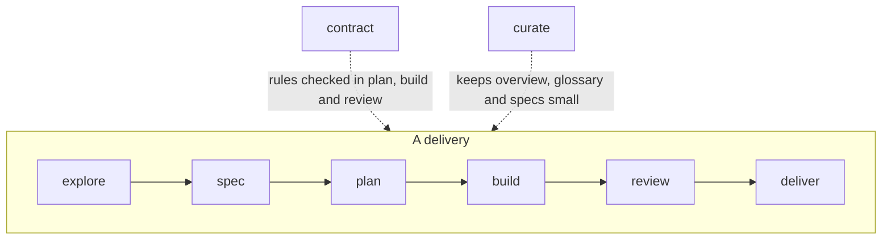

# The flow

Nine phases. Seven form the path of a delivery, with `fix` as the short
road for a defect; two are transversal. Each
phase has one word, and that word is the CLI command, the workflow file and
the skill. You invoke a phase with its skill; the skill runs the
phase command; the command refuses while a required step is missing and
otherwise prints the workflow, the rules and the context. [Guided
delivery](guided.md) follows one change through every step, with the
commands and the files each one writes.



| Phase | Say to your client | Produces | Who decides |
| --- | --- | --- | --- |
| [explore](explore.md) | `/atipspec-explore <slug>: <idea>` | `brief.md` | you: spec it, narrow it or drop it |
| [spec](spec.md) | `/atipspec-spec <slug>: <what you want>` | scenarios in `specs/<capability>.md`, the delivery's `spec.md` | you approve the proposal, with the plan. **Stop point 1** |
| [fix](fix.md) | `/atipspec-fix <slug>: <the defect>` | the accepted requirement it breaks, corrected, and a one-task plan | you approve the proposal. **Stop point 1** |
| [plan](plan.md) | `/atipspec-plan <slug>` | `plan.md`: scope, approach, tasks, final verification | part of the proposal |
| [build](build.md) | `/atipspec-build <slug>` | code and tests, `task-done` records, evidence | the developer with the model |
| [review](review.md) | `/atipspec-review <slug>` | `review.md` by the reviewer | `atipspec check` |
| [deliver](deliver.md) | `/atipspec-deliver <slug>` | your acceptance of the result, living spec updated, folder archived | you accept the result. **Stop point 2** |
| [contract](contract.md) | `/atipspec-contract` | `contract.md`, decisions | you approve, once per project |
| [curate](curate.md) | `/atipspec-curate` | `overview.md`, `glossary.md` | the model, within caps |

## What each phase requires

The phase command checks these before printing anything. When one is
missing, it exits 1 with a single line naming the step and who resolves it.

| Command | Requires |
| --- | --- |
| `atipspec explore <slug>` | the delivery exists (`atipspec new`) |
| `atipspec spec <slug>` | guided deliveries: nothing (`check` warns while the contract is not accepted); legacy deliveries: the contract's acceptance is recorded for its current content and decisions (`atipspec accept contract --code <code>`) |
| `atipspec fix <slug>` | the delivery was created with `--kind fix`; for a fix created before 0.3.0, also the contract's acceptance recorded for its current content |
| `atipspec plan <slug>` | guided deliveries: complete scenarios without a blocking specification finding (strict findings block with `strict_criteria: true`), a stated intent, decided out-of-scope and quality sections (for a fix, its defect stated and the requirements it corrects listed), and no open question; legacy deliveries: the spec is accepted for its current content (`atipspec accept <slug> spec --code <code>`) |
| `atipspec build <slug>` | guided deliveries: the current proposal is accepted (`atipspec accept <slug> proposal --code <code>`); legacy deliveries: a plan with tasks and no plan errors, accepted with `atipspec accept <slug> plan --code <code>` when `approve_plan` is on. It names the next task |
| `atipspec review <slug>` | every task recorded with `task-done` (or, in a legacy delivery, a commit marker), evidence fresh, no contract violation, reviews left (`review_rounds`, the first included); only then it writes the packet |
| `atipspec deliver <slug>` | the gate is green and your acceptance of the current result is recorded (`atipspec accept <slug> result --code <code>`); with a trust policy, the trusted gate is `verified` |
| `atipspec contract`, `atipspec curate` | nothing |
| `atipspec ship <slug>` | the delivery exists; prints the next phase to enter |

## Ship mode

```text
/atipspec-ship <slug>
```

`atipspec ship <slug>` names the next phase the delivery can enter; the model
enters it, finishes it and asks again. It runs plan, build, review and deliver
without pausing, except at the two stop points, at a material change to the
approved agreement, at a blocker and for questions that change the spec (and,
for a legacy delivery, at the plan approval when `approve_plan` is on). It
ends with one report: what changed, evidence, review outcome, deferred items,
next action. For unattended execution through a configured process, see
[the execution adapter](../reference/execution-adapter.md).

## Risk

Each guided delivery states `risk: low`, `normal` or `high` in its `spec.md`,
and you approve it with the proposal, which shows what the level asks of the
gate. `normal` asks a reviewer verdict for every criterion. `low` lets a
criterion whose named test passed go without a verdict, and cannot remove a
requirement or change the contract. `high` requires a declared scope, a named
test with a JUnit report for every automated criterion, and a review from an
isolated session. The level adds or removes no approval; changing it after
the approval voids that approval. See [risk](spec.md#risk).

## Stop points

!!! warning "Stop point 1: the proposal"
    Nothing is built until you approve the proposal: scenarios, approach,
    tests and risk together (the spec, for a legacy delivery). You approve in
    the conversation; the assistant records it with `atipspec accept <slug>
    proposal --code <code>`, naming the code `atipspec proposal <slug>`
    showed you. Claude Code, configured by `init` and opened at the project
    root, asks you before that command runs, and the record states that
    channel. The command sets
    `status: ready` and records what you accepted. This is where a wrong idea
    costs the least.

!!! warning "Stop point 2: the result"
    Nothing is archived until you accept the reviewed result. The assistant
    presents `atipspec report <slug>`: each criterion with its evidence and
    verdict, and every changed file with the diff. You accept in the
    conversation; the assistant records it with `atipspec accept <slug> result
    --code <code>`, and `deliver` then updates the living spec and archives the
    delivery on its branch. Commit, push and merge follow your repository's
    policy: `atipspec merge-check --base <target>` confirms that every delivery
    the branch touches is accepted and that its code is still the accepted
    code. AtipSpec never pushes or merges.

## Roles

The phase triggers what the model does, not you: the phase command prints
the phase it opens ("Phase spec: Password reset (password-reset)"). The
explore, fix, contract and curate workflows open with the role the model
adopts there. The guided phases describe the work instead, and the six
guided roles (guide, analyst, designer, tester, implementer and reviewer)
are instructions `atipspec context --role` prints and the process runner
sends; `risk` adjusts them.
