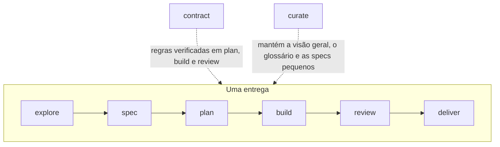

# O fluxo

Nove fases. Sete formam o caminho de uma entrega, com `fix` como o caminho
curto para um defeito; duas são transversais. Cada fase tem uma palavra, e
essa palavra é o comando da CLI, o arquivo de workflow e a skill. Você invoca
uma fase com sua skill; a skill executa o comando da fase; o comando recusa
enquanto um passo obrigatório estiver faltando e, caso contrário, imprime o
workflow, as regras e o contexto. A [entrega guiada](guided.md) acompanha
uma mudança por todos os passos, com os comandos e os arquivos que cada um
escreve.



| Fase | O que dizer ao seu cliente | Produz | Quem decide |
| --- | --- | --- | --- |
| [explore](explore.md) | `/atipspec-explore <slug>: <idea>` | `brief.md` | você: faça a spec, reduza o escopo ou descarte |
| [spec](spec.md) | `/atipspec-spec <slug>: <what you want>` | cenários em `specs/<capability>.md`, o `spec.md` da entrega | você aprova a proposta, com o plano. **Ponto de parada 1** |
| [fix](fix.md) | `/atipspec-fix <slug>: <the defect>` | o requisito aceito que ele quebra, corrigido, e um plano de uma tarefa | você aprova a proposta. **Ponto de parada 1** |
| [plan](plan.md) | `/atipspec-plan <slug>` | `plan.md`: escopo, abordagem, tarefas, verificação final | parte da proposta |
| [build](build.md) | `/atipspec-build <slug>` | código e testes, registros de `task-done`, evidência | o desenvolvedor com o modelo |
| [review](review.md) | `/atipspec-review <slug>` | `review.md` pelo revisor | `atipspec check` |
| [deliver](deliver.md) | `/atipspec-deliver <slug>` | sua aceitação do resultado, spec viva atualizada, pasta arquivada | você aceita o resultado. **Ponto de parada 2** |
| [contract](contract.md) | `/atipspec-contract` | `contract.md`, decisões | você aprova, uma vez por projeto |
| [curate](curate.md) | `/atipspec-curate` | `overview.md`, `glossary.md` | o modelo, dentro dos limites |

## O que cada fase exige

O comando da fase verifica isso antes de imprimir qualquer coisa. Quando um
deles está faltando, ele sai com código 1 e uma única linha nomeando o
passo e quem o resolve.

| Comando | Exige |
| --- | --- |
| `atipspec explore <slug>` | a entrega existe (`atipspec new`) |
| `atipspec spec <slug>` | entregas guiadas: nada (`check` avisa enquanto o contrato não está aceito); entregas antigas: a aceitação do contrato está registrada para seu conteúdo e suas decisões atuais (`atipspec accept contract --code <code>`) |
| `atipspec fix <slug>` | a entrega foi criada com `--kind fix`; para um fix criado antes da 0.3.0, também a aceitação do contrato registrada para seu conteúdo atual |
| `atipspec plan <slug>` | entregas guiadas: cenários completos sem um achado de especificação bloqueante (os achados estritos bloqueiam com `strict_criteria: true`), uma intenção declarada, seções de fora do escopo e de qualidade decididas (para um fix, seu defeito declarado e os requisitos que ele corrige listados), e nenhuma pergunta em aberto; entregas antigas: a spec está aceita para seu conteúdo atual (`atipspec accept <slug> spec --code <code>`) |
| `atipspec build <slug>` | entregas guiadas: a proposta atual está aceita (`atipspec accept <slug> proposal --code <code>`); entregas antigas: um plano com tarefas e sem erros de plano, aceito com `atipspec accept <slug> plan --code <code>` quando `approve_plan` está ativo. Ele nomeia a próxima tarefa |
| `atipspec review <slug>` | toda tarefa registrada com `task-done` (ou, em uma entrega antiga, um marcador de commit), evidência atualizada, nenhuma violação do contrato, revisões restantes (`review_rounds`, contando a primeira); só então ele escreve o pacote |
| `atipspec deliver <slug>` | o portão está verde e sua aceitação do resultado atual está registrada (`atipspec accept <slug> result --code <code>`); com uma política de confiança, o portão confiável está `verified` |
| `atipspec contract`, `atipspec curate` | nada |
| `atipspec ship <slug>` | a entrega existe; imprime a próxima fase em que entrar |

## Modo ship

```text
/atipspec-ship <slug>
```

`atipspec ship <slug>` nomeia a próxima fase em que a entrega pode entrar; o
modelo entra nela, termina e pergunta de novo. Ele executa plan, build,
review e deliver sem pausar, exceto nos dois pontos de parada, diante de uma
mudança material no acordo aprovado, diante de um bloqueio e para perguntas
que mudam a spec (e, em uma entrega antiga, na aprovação do plano quando
`approve_plan` está ativo). Termina com um relatório: o que mudou,
evidência, resultado do review, itens adiados, próxima ação. Para uma
execução não assistida por meio de um processo configurado, veja
[o adaptador de execução](../reference/execution-adapter.md).

## Risco

Cada entrega guiada declara `risk: low`, `normal` ou `high` em seu `spec.md`,
e você o aprova com a proposta, que mostra o que o nível pede do portão.
`normal` pede um veredito do revisor para cada critério. `low` deixa sem
veredito um critério cujo teste nomeado passou, e não pode remover um
requisito nem mudar o contrato. `high` exige um escopo declarado, um teste
nomeado com um relatório JUnit para cada critério automatizado e um review
de uma sessão isolada. O nível não adiciona nem remove nenhuma aprovação;
mudá-lo depois da aprovação anula essa aprovação. Veja [risco](spec.md#risco).

## Pontos de parada

!!! warning "Ponto de parada 1: a proposta"
    Nada é construído até você aprovar a proposta: cenários, abordagem,
    testes e risco juntos (a spec, em uma entrega antiga). Você aprova na
    conversa; o assistente registra isso com `atipspec accept <slug>
    proposal --code <code>`, informando o código que `atipspec proposal
    <slug>` mostrou a você. O Claude Code, configurado pelo `init` e aberto
    na raiz do projeto, pergunta a você antes de esse comando rodar, e o
    registro declara esse canal. O
    comando define `status: ready` e registra o que você aceitou. É aqui que
    uma ideia errada custa menos.

!!! warning "Ponto de parada 2: o resultado"
    Nada é arquivado até você aceitar o resultado revisado. O assistente
    apresenta `atipspec report <slug>`: cada critério com sua evidência e seu
    veredito, e cada arquivo alterado com o diff. Você aceita na conversa; o
    assistente registra isso com `atipspec accept <slug> result --code
    <code>`, e `deliver` então atualiza a spec viva e arquiva a entrega em
    seu branch. Commit, push e merge seguem a política do seu repositório:
    `atipspec merge-check --base <target>` confirma que cada entrega que o
    branch toca está aceita e que seu código ainda é o código aceito. O
    AtipSpec nunca faz push nem merge.

## Papéis

A fase aciona o que o modelo faz, não você: o comando da fase imprime a fase
que abre ("Phase spec: Password reset (password-reset)"). Os workflows de
explore, fix, contract e curate começam com o papel que o modelo adota ali.
As fases guiadas descrevem o trabalho em vez disso, e os seis papéis guiados
(guide, analyst, designer, tester, implementer e reviewer) são instruções
que `atipspec context --role` imprime e o executor de processos envia;
`risk` os ajusta.
