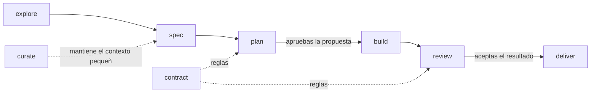

# AtipSpec

**Entrega dirigida por especificación para clientes de programación con LLM.
El desarrollador dirige, el modelo propone, el CLI comprueba la evidencia y
la aceptación de confianza.**

Sigues hablando con el cliente de programación que ya usas: Claude Code,
Codex, Cursor, GitHub Copilot, Gemini CLI o Antigravity. AtipSpec da al
modelo un manual de operación corto, un workflow por fase y una herramienta
de línea de comandos que se encarga de todo lo que no debe depender del
juicio del modelo.

-   :material-file-document-check: **La spec es la verdad**

    Cada entrega empieza con escenarios que apruebas en la conversación,
    junto con el enfoque y las pruebas; si los editas después, la puerta te
    vuelve a preguntar. El revisor juzga el código contra ellos, criterio a
    criterio.

-   :material-shield-check: **El contrato es la ley**

    Un contrato de arquitectura con reglas comprobadas por máquina: stack,
    capas, dependencias, comandos obligatorios. La deriva se rechaza, no se
    discute.

-   :material-check-decagram: **Evidencia con procedencia autenticada**

    `atipspec verify` ejecuta tus comandos de test y registra los códigos de
    salida atados al árbol de trabajo. El éxito local es `checked`;
    `verified` exige además evidencia de CI firmada y aprobaciones humanas
    atadas al contenido.

-   :material-source-branch: **Registros en tu repositorio**

    Las aprobaciones, el avance de las tareas, la evidencia y los recibos son
    ficheros junto al código, cada uno atado al contenido que cubre. Si ese
    contenido cambia, la puerta vuelve a preguntar. Sin servicio, sin base de
    datos.

-   :material-account-eye: **Una revisión adversarial**

    Un revisor en una sesión aislada lee un paquete, no tu conversación, y
    escribe un PASS o FAIL por criterio, cada uno apuntando a una prueba que
    la puerta puede encontrar.

-   :material-scale-balance: **Un contexto que se mantiene pequeño**

    `atipspec context` carga exactamente lo que una entrega necesita y lo
    mide contra un presupuesto. El coste depende de la entrega, no de la
    edad del proyecto.

## El flujo en treinta segundos

1. **explore** una idea que aún no está clara, si hace falta.
2. **spec** con el modelo en una entrevista: escenarios en la spec viva; o
   **fix** un defecto sin la entrevista, corrigiendo el requisito aceptado
   que rompe.
3. **plan** el enfoque, los ficheros que tocará y las pruebas. Apruebas
   escenarios, enfoque y pruebas juntos, una sola vez, en la conversación:
   la propuesta. El asistente lo registra con `atipspec accept --code`, el
   código de lo que te mostró.
4. **build** tarea a tarea, registrando cada una con `task-done`; `verify`
   ejecuta las comprobaciones finales una vez.
5. **review** por un revisor en una sesión aislada.
6. **deliver**: aceptas el resultado revisado, con su evidencia y su diff;
   la spec viva se actualiza y la entrega se archiva. El commit, la fusión y
   el despliegue siguen la política de tu repositorio; `merge-check`
   confirma la branch antes de la fusión.

Tomas tres decisiones: el contrato, una vez; cada propuesta, y cada
resultado. Una organización que necesita aprobaciones autenticadas añade una
policy de confianza externa, en la que producto, ingeniería y QA firman con
identidades inscritas. Consulta la [entrega guiada](flow/guided.md) de
principio a fin, y la [aceptación empresarial](enterprise.md) para el
perímetro de confianza.

[Instalar AtipSpec](getting-started/installation.md){ .md-button .md-button--primary }
[Primeros pasos](getting-started/quick-start.md){ .md-button }
