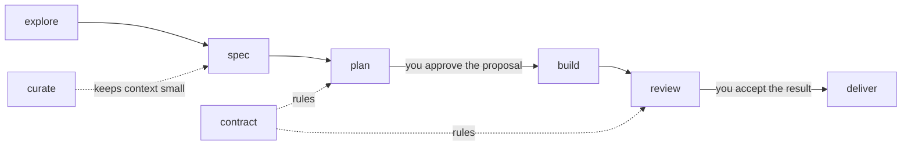

# AtipSpec

**Spec-driven delivery for LLM coding clients. The developer leads, the model
proposes, the CLI checks evidence and trusted acceptance.**

You keep talking to the coding client you already use: Claude Code, Codex,
Cursor, GitHub Copilot, Gemini CLI or Antigravity. AtipSpec gives the model a
short operating manual, one workflow per phase, and a command-line tool that
owns everything that must not depend on the model's judgment.

-   :material-file-document-check: **The spec is the truth**

    Every delivery starts with scenarios you approve in the conversation,
    together with the approach and the tests; edit them afterwards and the
    gate asks you again. The reviewer judges the code against them, criterion
    by criterion.

-   :material-shield-check: **The contract is the law**

    An architecture contract with machine-checked rules: stack, layers,
    dependencies, required commands. Drift is refused, not discussed.

-   :material-check-decagram: **Evidence with authenticated provenance**

    `atipspec verify` runs your test commands and records exit codes bound
    to the working tree. Local success is `checked`; `verified` additionally
    requires signed CI evidence and content-bound human approvals.

-   :material-source-branch: **Records in your repository**

    Approvals, task progress, evidence and receipts are files next to the
    code, each bound to the content it covers. Change that content and the
    gate asks again. No service, no database.

-   :material-account-eye: **One adversarial review**

    A reviewer in an isolated session reads a packet, not your conversation,
    and writes one PASS or FAIL per criterion, each pointing to proof the gate
    can find.

-   :material-scale-balance: **Context that stays small**

    `atipspec context` loads exactly what a delivery needs and measures it
    against a budget. Cost depends on the delivery, not on the age of the
    project.

## The flow in thirty seconds

1. **explore** an idea that is not clear yet, if needed.
2. **spec** it with the model in an interview: scenarios in the living spec;
   or **fix** a defect without the interview, by correcting the accepted
   requirement it breaks.
3. **plan** the approach, the files it will touch and the tests. You approve
   scenarios, approach and tests together, once, in the conversation: the
   proposal. The assistant records it with `atipspec accept --code`, the code
   of what it showed you.
4. **build** task by task, recording each one with `task-done`; `verify` runs
   the final checks once.
5. **review** by a reviewer in an isolated session.
6. **deliver**: you accept the reviewed result, with its evidence and its
   diff; the living spec is updated and the delivery archived. Commit, merge
   and deployment follow your repository's policy; `merge-check` confirms the
   branch before the merge.

You make three decisions: the contract once, each proposal and each result.
An organization that needs authenticated approvals adds an external trust
policy, where product, engineering and QA sign with enrolled identities. See
the [guided delivery](flow/guided.md) end to end, and [enterprise
acceptance](enterprise.md) for the trust boundary.

[Install AtipSpec](getting-started/installation.md){ .md-button .md-button--primary }
[Quick start](getting-started/quick-start.md){ .md-button }
