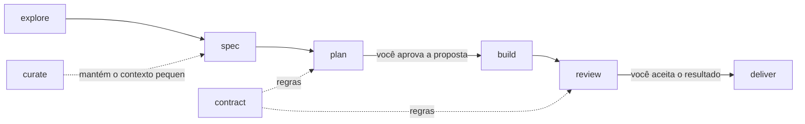

# AtipSpec

**Entrega guiada por especificação para clientes de programação com LLM. O
desenvolvedor conduz, o modelo propõe, a CLI verifica a evidência e a
aceitação confiável.**

Você continua conversando com o cliente de programação que já usa: Claude
Code, Codex, Cursor, GitHub Copilot, Gemini CLI ou Antigravity. O AtipSpec dá
ao modelo um manual de operação curto, um workflow por fase e uma ferramenta
de linha de comando que é dona de tudo o que não deve depender do julgamento
do modelo.

-   :material-file-document-check: **A spec é a verdade**

    Cada entrega começa com cenários que você aprova na conversa, junto com
    a abordagem e os testes; se alguém os editar depois, o portão pergunta a
    você de novo. O revisor julga o código contra eles, critério por
    critério.

-   :material-shield-check: **O contrato é a lei**

    Um contrato de arquitetura com regras verificadas por máquina: stack,
    camadas, dependências, comandos obrigatórios. O desvio é recusado, não
    discutido.

-   :material-check-decagram: **Evidência com procedência autenticada**

    `atipspec verify` executa seus comandos de teste e registra os códigos de
    saída vinculados à árvore de trabalho. O sucesso local é `checked`;
    `verified` exige também evidência de CI assinada e aprovações humanas
    vinculadas ao conteúdo.

-   :material-source-branch: **Registros no seu repositório**

    Aprovações, progresso das tarefas, evidências e recibos são arquivos ao
    lado do código, cada um vinculado ao conteúdo que cobre. Se esse conteúdo
    mudar, o portão pergunta de novo. Sem serviço, sem banco de dados.

-   :material-account-eye: **Uma revisão adversarial**

    Um revisor em uma sessão isolada lê um pacote, não a sua conversa, e
    escreve um PASS ou FAIL por critério, cada um apontando para uma prova
    que o portão consegue encontrar.

-   :material-scale-balance: **Um contexto que continua pequeno**

    `atipspec context` carrega exatamente o que uma entrega precisa e mede
    isso contra um orçamento. O custo depende da entrega, não da idade do
    projeto.

## O fluxo em trinta segundos

1. **explore** uma ideia que ainda não está clara, se necessário.
2. **spec** com o modelo em uma entrevista: cenários na spec viva; ou **fix**
   um defeito sem entrevista, corrigindo o requisito aceito que ele quebra.
3. **plan** a abordagem, os arquivos que serão tocados e os testes. Você
   aprova cenários, abordagem e testes juntos, uma única vez, na conversa: a
   proposta. O assistente a registra com `atipspec accept --code`, o código
   do que ele mostrou a você.
4. **build** tarefa por tarefa, registrando cada uma com `task-done`;
   `verify` executa as verificações finais uma única vez.
5. **review** por um revisor em uma sessão isolada.
6. **deliver**: você aceita o resultado revisado, com sua evidência e seu
   diff; a spec viva é atualizada e a entrega, arquivada. Commit, merge e
   deploy seguem a política do seu repositório; `merge-check` confirma a
   branch antes do merge.

Você toma três decisões: o contrato, uma vez; cada proposta; e cada
resultado. Uma organização que precisa de aprovações autenticadas adiciona
uma política de confiança externa, na qual produto, engenharia e QA assinam
com identidades registradas. Veja a [entrega guiada](flow/guided.md) de ponta
a ponta, e a [aceitação empresarial](enterprise.md) para o perímetro de
confiança.

[Instalar o AtipSpec](getting-started/installation.md){ .md-button .md-button--primary }
[Primeiros passos](getting-started/quick-start.md){ .md-button }
